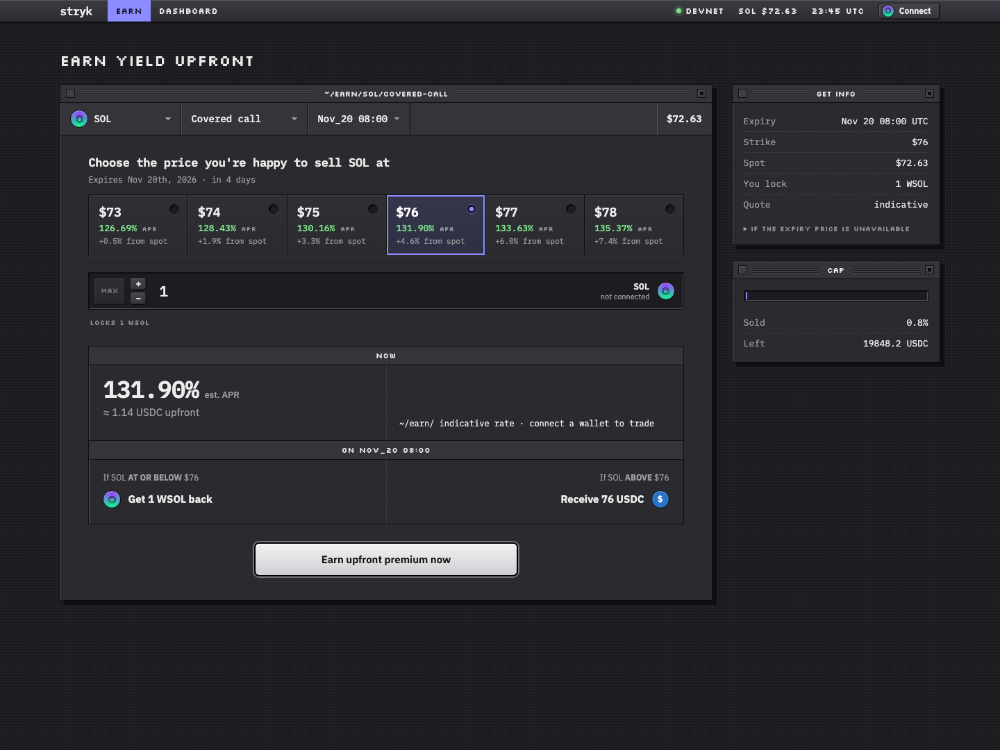
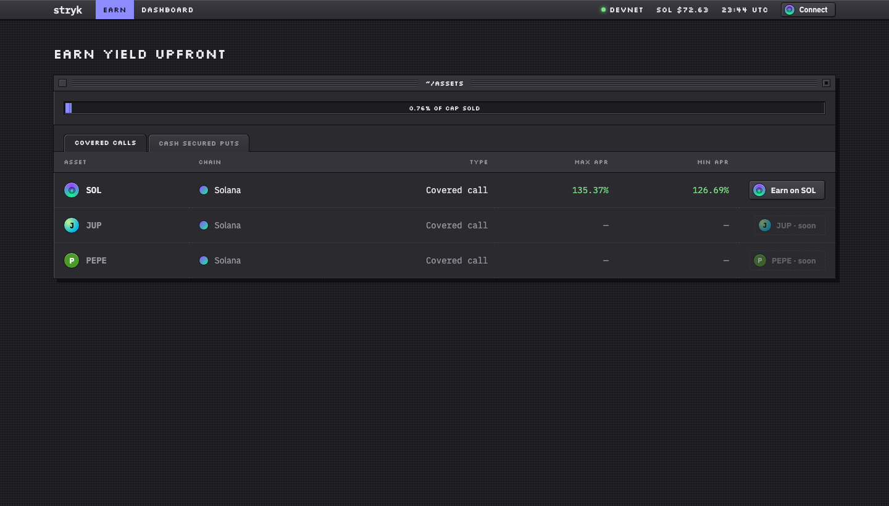
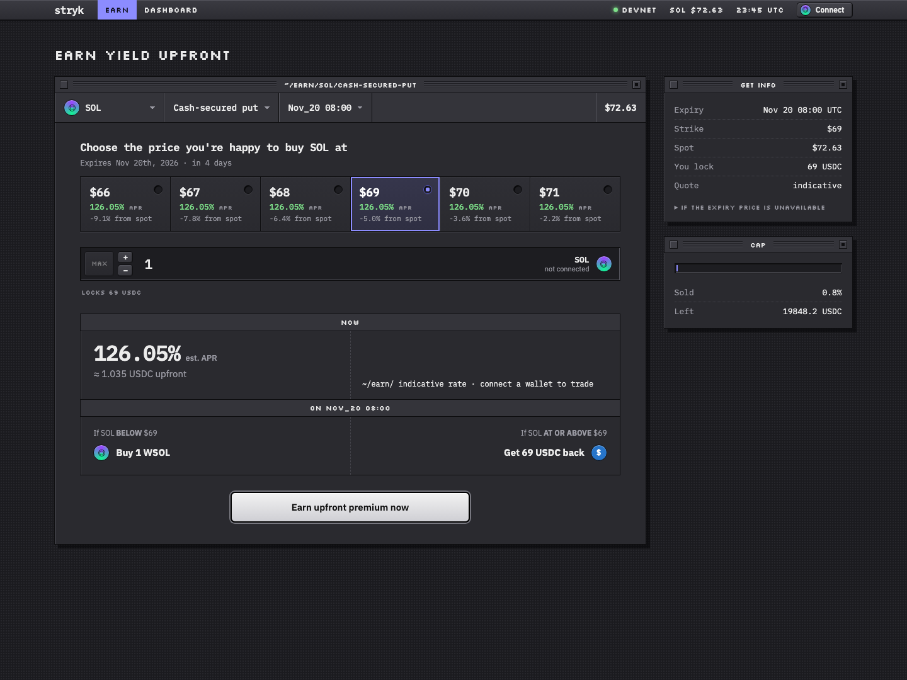
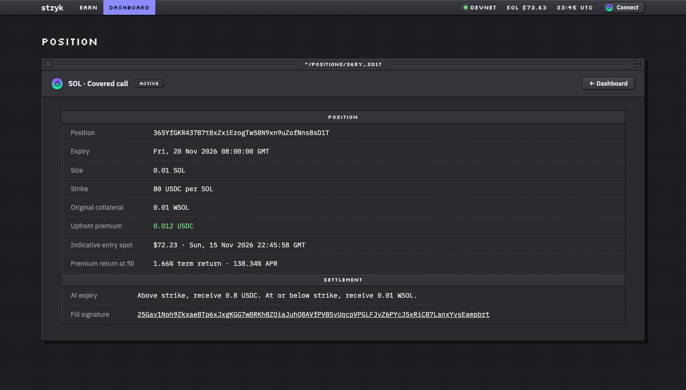
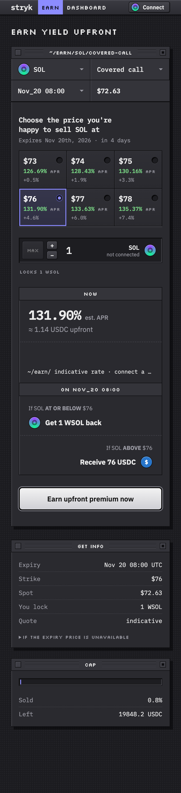

# Stryk

Sell covered calls and cash-secured puts on Solana and get paid in USDC upfront. At expiry the program settles by physical delivery.



| Earn | Cash-secured put | Position receipt | Phone |
| --- | --- | --- | --- |
|  |  |  |  |

The design spec is in [RFC.md](RFC.md).

## How it works

- **Writers** choose a strike, an expiry and a size, then sign one transaction. Their collateral goes into escrow and they receive the premium straight away.
  - Covered call: lock SOL (as WSOL).
  - Cash-secured put: lock USDC.
- **Makers** compete in a two-second auction. The highest signed premium wins. The maker's side of the trade is locked in the same fill.
- **At expiry** a verified Pyth SOL/USD price fixes the outcome.
  - In the money: the two sides swap at the strike.
  - Otherwise: each side gets its collateral back.
- **No price by the deadline** (24 hours after expiry): both sides get their collateral back, and the writer keeps the premium.
- **Settlement is permissionless.** The service's worker settles automatically, but anyone can settle a position with the CLI.

## Repository layout

| Path | What it is |
| --- | --- |
| `programs/stryk` | Solana program (Quasar). Markets, expiries, maker lanes, caps, fills, fixes and settlement. |
| `crates/stryk-core` | Shared math, quote encoding and Pyth account parsing. Builds for SBF, native and WASM. |
| `crates/stryk-client` | Generated instruction builders, PDAs and API types shared by every app. |
| `apps/service` | Rust service: RFQ auction, maker WebSocket, finalized indexer (Postgres) and settlement worker. Also serves the web app. |
| `apps/web` | Dioxus web app: Earn, ticket, dashboard and position receipts. Uses Wallet Standard for signing. |
| `apps/cli` | Maker bot, admin and bootstrap commands, inventory, inspection and manual fix/settle. |
| `scripts` | Local smoke tests, web build and client generation. |
| `tests` | Test-only Pyth fixture receiver and recorded run evidence. |

## Requirements

- Rust 1.96.1
- Agave 3.1.14 and platform-tools v1.52 (to build and run the program)
- wasm-bindgen-cli 0.2.130 (to build the web app)
- Postgres 16, local or in Docker
- Optional: Quasar CLI at rev `37e8a6b4`, to regenerate the client

## Run it locally

1. Build the web app with the local test wallet:
   ```sh
   STRYK_LOCAL_WALLET=1 bash scripts/build-web.sh
   ```
2. Start a validator, Postgres, the service and three demo makers:
   ```sh
   STRYK_SMOKE_POSTGRES_IMAGE=postgres:16.11-alpine bash scripts/local-smoke.sh app
   ```
3. Open the printed `127.0.0.1` URL and connect **Local demo wallet**. Pick a strike and size, then press **Earn upfront premium now**.

Notes:
- The local test wallet only exists in `STRYK_LOCAL_WALLET=1` builds and only appears on `127.0.0.1` against localnet.
- Set `STRYK_PLATFORM_TOOLS` if platform-tools is already unpacked, and `STRYK_SMOKE_PORT` if the default port is busy.

## Tests and checks

| Command | What it covers |
| --- | --- |
| `bash scripts/local-smoke.sh` | Call and put fills plus physical assignment on a throwaway validator. Checks exact token movements. |
| `bash scripts/local-smoke.sh timeout` | No-price refund after the fix deadline. |
| `bash scripts/local-smoke.sh admin` | Market creation, maker admission, caps and pause. |
| `bash scripts/local-smoke.sh rfq` | Full auction with three makers. The highest eligible bid wins. |
| `bash scripts/local-smoke.sh race` | Two writers competing for one maker's funds. |
| `bash scripts/local-smoke.sh recovery` | Restarts during an RFQ and after settlement, plus a database rebuild from chain. |
| `bash scripts/local-smoke.sh load` | Auction benchmark at 100 and 400 RFQs/s. |
| `bash scripts/local-smoke.sh drain` | Settles 32 positions at one expiry. |
| `cargo test --workspace --all-features --locked` | Native unit and integration tests. |

CI (`.github/workflows/checks.yml`) runs `cargo fmt --check`, workspace clippy, and wasm clippy for the web crate.

## Deploy to devnet

1. Generate a program keypair. Put its address in `declare_id!` (`programs/stryk/src/lib.rs`) and in `crates/stryk-client/src/generated.rs`.
2. Build the program with `cargo build-sbf --tools-version v1.52`, then deploy it with `solana program deploy`.
3. Create a 6-decimal test USDC mint, then set up the market with the CLI. Pass `--devnet --rpc <devnet rpc>` before each subcommand.
   - `admin initialize-market --quote-mint <mint> --receiver rec2HHDDnjLfj4kE7VyEtFA1HPGQLK33259532cRyHp --domain <random pubkey>`
   - `admin create-expiry --market <market> --expires-at <Friday 08:00 UTC>`
   - `admin register-lane`, then `admin set-capacity` for each expiry
   - Have the maker wrap SOL, then `inventory --deposit` both USDC and WSOL
4. Build the web app pinned to that deployment:
   ```sh
   STRYK_WEB_CLUSTER=solana:devnet STRYK_WEB_MARKET=<market> \
   STRYK_WEB_DOMAIN=<domain> STRYK_WEB_QUOTE_MINT=<mint> bash scripts/build-web.sh
   ```
5. Run `stryk-service` with `STRYK_CLUSTER=solana:devnet` and the RPC, market, database and web-dir settings below. Then start `stryk-cli maker` for the market.

Current devnet deployment:
- Program: `FKqz2KahLp32F1cwKcsU3sCkcerZWBXE4F9H1irBSAVf`
- Market: `6M8dK5TQLUd85NBsWjrEv9DbiTCJ4anxGyaisYyjudNN`
- Test USDC: `QN3FoWCCsGcrC4MXKxaBvkfbPD7ooyfXkrYB66yovdK`

## Service configuration

| Variable | Purpose |
| --- | --- |
| `STRYK_LISTEN` | Listen address (default `127.0.0.1:8080`). |
| `STRYK_RPC` | Solana RPC. Use a keyed provider on devnet; public endpoints rate-limit. |
| `STRYK_CLUSTER` | `solana:localnet`, `solana:devnet` or `solana:mainnet`. Checked against the RPC genesis hash. |
| `STRYK_MARKET` | Market address to serve. |
| `STRYK_AUDIENCE` | Maker auth audience. Makers must use the same value. |
| `STRYK_DATABASE_URL` | Postgres for finalized positions and receipts. |
| `STRYK_WEB_DIR` | Built web app to serve. |
| `STRYK_SETTLEMENT_PAYER` | Fee-payer keypair for the settlement worker. |
| `STRYK_PYTH_POSTER`, `STRYK_PYTH_API_KEY`, `STRYK_PYTH_ARCHIVE` | Posting historical Pyth prices at expiry. Without them, positions refund after the deadline. |
| `STRYK_ARCHIVE_RPC` | Archival RPC for gaps in transaction history. |

The `Dockerfile` builds one image containing the service and the web app. Pass the four `STRYK_WEB_*` values as build arguments.

## Health and metrics

- `/health`: the process is up.
- `/ready`: the market is readable and a fresh spot price is available.
- `/metrics`: Prometheus metrics. The ones to watch:
  - `stryk_rpc_rate_limited_total`
  - `stryk_receipt_scan_slot_lag`
  - `stryk_oldest_unsettled_seconds`
  - `stryk_pending_fixes`
  - `stryk_no_fix_expiries`

## Known limits

- **SOL/USDC only.** JUP and PEPE are listed as coming soon. Adding them needs a per-market price feed and decimals in the program, and a multi-market service.
- **Fixing at the real price needs a Pyth API key** for historical prices. Without one, devnet positions refund after the deadline.
- **Stale devnet prices.** Pyth refreshes the devnet SOL/USD account every few minutes. The service only quotes off a price under 120 seconds old, so devnet quoting can pause between updates.
- **Locked maker capital.** Makers prefund both sides of every position until expiry.
